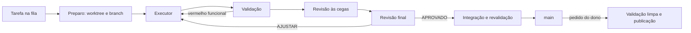
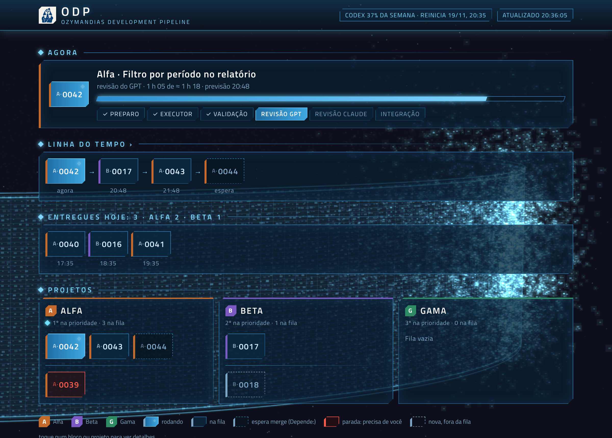
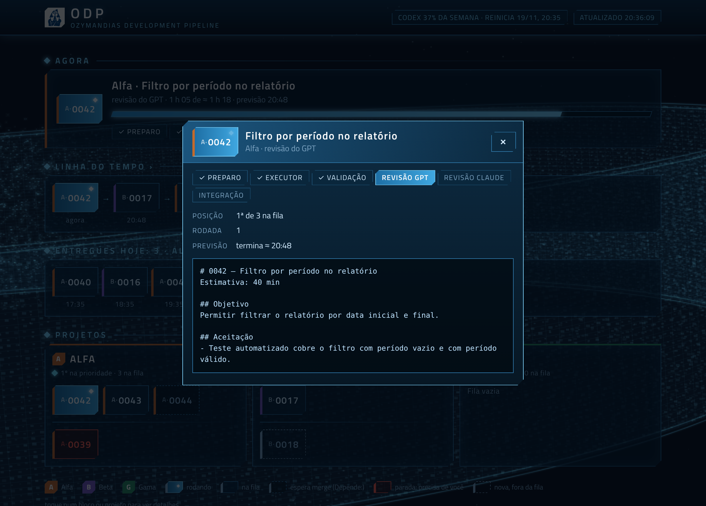
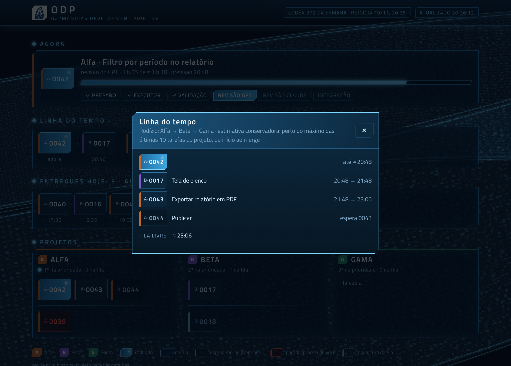
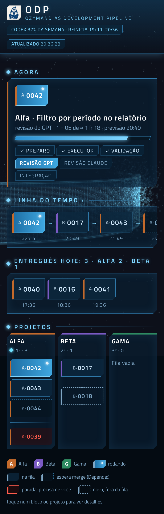

# ODP · Ozymandias Development Pipeline

Pipeline que leva uma tarefa de software, escrita em arquivo, da especificação até a branch principal (e até a produção quando o dono pede), com agentes de IA implementando e revisando e um controlador em código decidindo cada avanço.

## O problema

Construo software para três projetos em paralelo. Sem um pipeline, cada tarefa exigia passos manuais: copiar o pedido para o agente, rodar testes, conferir a revisão, resolver conflitos, mesclar e publicar.

O ODP faz essa operação sozinho, um projeto por vez, e só me chama para o que é decisão minha: regra de produto, mudança de regra do próprio pipeline e ações que exigem presença física.

## Estado atual

- **Em uso diário desde 21/10/2026**, num PC Windows. A Constituição 2.0, que é a base atual, é de 28/10/2026; a versão em uso hoje é a 2.10.2 (16/11/2026).
- **Projetos atendidos:**
  - um sistema de gestão do Grupo CBM, em produção e publicado pelo próprio ODP;
  - dois jogos em desenvolvimento.
- **Usuário:** só eu.

## Como funciona

1. **Especificação.** Uma conversa de produto escreve a tarefa em Markdown, com objetivo, escopo, fora do escopo, critérios de aceitação e estimativa, e a coloca na fila (`FILA.md`).
2. **Escolha.** O vigia (um processo Node.js) escolhe o projeto por prioridade e rodízio e grava o estado antes de cada etapa. Uma queda ou um reinício retoma a tarefa da etapa em que parou.
3. **Preparo.** Cria uma branch da tarefa numa worktree Git isolada, a partir da main atual.
4. **Execução.** O agente executor implementa a tarefa e entrega um relatório. Ele pode pedir que passos de teste rodem na mesma rodada.
5. **Validação.** Antes de qualquer commit roda o verificador de privacidade; depois, os testes, o lint e o build do projeto. Se um teste funcional falha, a tarefa volta direto ao executor, sem passar pela revisão.
6. **Revisão.** Primeiro uma revisão às cegas, depois a revisão final, que dá o veredito: APROVADO, AJUSTAR ou PARAR. AJUSTAR abre uma nova rodada, até o máximo de 3.
7. **Integração.** A tarefa é mesclada com a main atual e validada de novo. Se a validação passar, entra na main; se houver conflito ou falha, a main não é tocada.
8. **Publicação (só quando o dono pede).** O ODP clona o commit numa pasta nova e roda a validação completa do zero. Só então executa o script de publicação do projeto e marca uma tag de produção.

Uma tarefa que para passa por uma triagem automática: ela é repetida, tem o escopo esclarecido, ou vira um aviso no meu celular com a pergunta.

## Como a IA é usada

- **Executor:** Codex, numa sandbox com escrita só na worktree e sem rede. Quando a cota do Codex acaba, o Claude assume como reserva.
- **Revisão às cegas:** o GPT, só com leitura, revisa sem saber qual agente desenvolveu e sem ver outra opinião.
- **Revisão final:** o Claude, só com ferramentas de leitura, recebe o parecer do GPT e aceita ou rejeita cada pendência. É o único veredito que vale.
  - Uma pendência só bloqueia a tarefa se vier com local, cenário e evidência.
  - O executor pode contestar uma pendência com um teste.
- **Triagem:** numa parada, o Claude, sem ferramentas, só pode repetir a tarefa, reduzir o escopo ou chamar o dono. Ele nunca amplia o escopo nem decide produto.
- **Automático, decidido em código:** avançar de etapa, validar, commitar, contar rodadas, impor limites de tempo, mesclar, publicar a pedido, registrar eventos e enviar avisos.
- **Depende de mim:** escrever e priorizar tarefas (com as conversas de produto), decisões de produto, pedir publicação e autorizar mudanças de regra.

## Regras do pipeline

O ODP segue um documento único e obrigatório, a Constituição. Onde código, prompt ou instrução contradizem esse documento, vale o documento. Ele garante que:

- uma regra só muda com a minha autorização explícita, e toda mudança pode ser desfeita;
- os projetos não se misturam: nenhum prompt de um projeto leva conteúdo de outro;
- dados reais nunca entram nos repositórios, e um verificador de privacidade roda antes de cada commit;
- a produção só é tocada a meu pedido; o backup do banco vai para fora do repositório, e o banco nunca é restaurado automaticamente;
- agente nenhum aprova o próprio trabalho: o veredito vem da revisão final, e o avanço é decidido pelo controlador.

## Números

Medidos no estado do ODP dos três projetos, de 21/10 a 16/11/2026.

| | |
|---|---|
| Tarefas mescladas na main | **352** |
| Publicações em produção | **14** |
| Aprovadas na 1ª rodada | **57%** (198 de 349 com registro de rodadas) |
| Rodadas por tarefa | média de **1,49** (198 com 1 rodada, 131 com 2, 20 com 3) |
| Projetos atendidos | **3** |
| Testes automatizados do próprio ODP | **92** |

Uma rodada é uma passagem do executor. Uma volta por teste vermelho ou por AJUSTAR conta como nova rodada.

## Capturas de tela

Painel do ODP com dados fictícios.

| | |
|---|---|
|  |  |
|  |  |

## Decisões relevantes

1. **O controlador decide, os agentes executam.** Motivo: um agente não pode aprovar o próprio trabalho nem pular a validação.
2. **Revisão às cegas por outro modelo antes do veredito final.** Motivo: separar quem desenvolve de quem julga e reduzir o viés de um modelo avaliar o próprio estilo.
3. **Comunicação só por arquivos, sem servidor nem banco.** Motivo: simplicidade. Tudo fica registrado no disco e pode ser lido e conferido por mim ou por qualquer conversa.
4. **A triagem só reduz o escopo, nunca amplia nem decide produto.** Motivo: uma parada automática não pode virar mudança de produto sem o dono.
5. **O estado é gravado antes de cada etapa.** Motivo: uma queda de energia ou um reinício retomam a tarefa de onde ela parou, sem perder o trabalho.

## Tecnologia

- Node.js (módulos ES) e testes com `node:test`, com agentes simulados e Git local.
- Git com worktrees e branches por tarefa.
- PowerShell 7 para os comandos de validação e publicação de cada projeto.
- Codex CLI (executor e revisão às cegas) e Claude Code CLI (revisão final, triagem e reserva).
- Painel web local instalável (PWA) e avisos no celular via ntfy.

## Sobre o código

O repositório do ODP é privado; esta é a vitrine pública.
